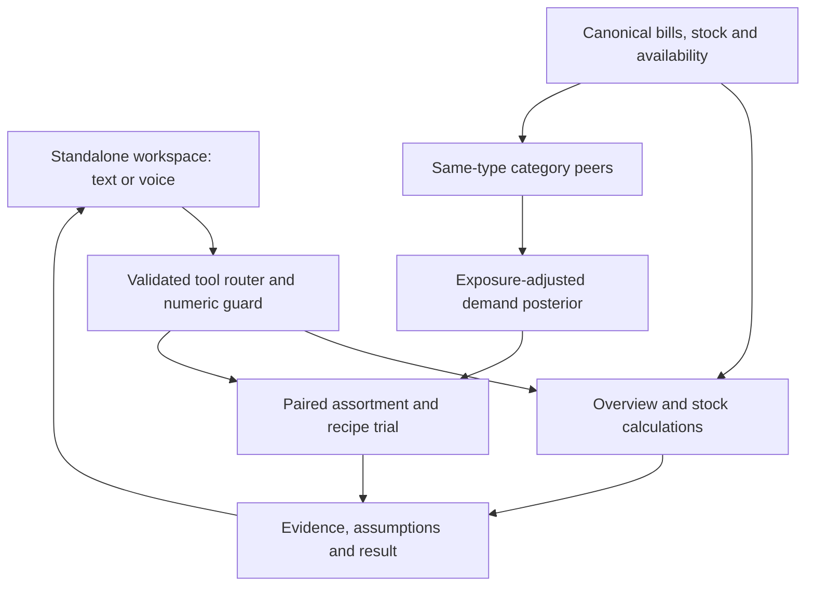
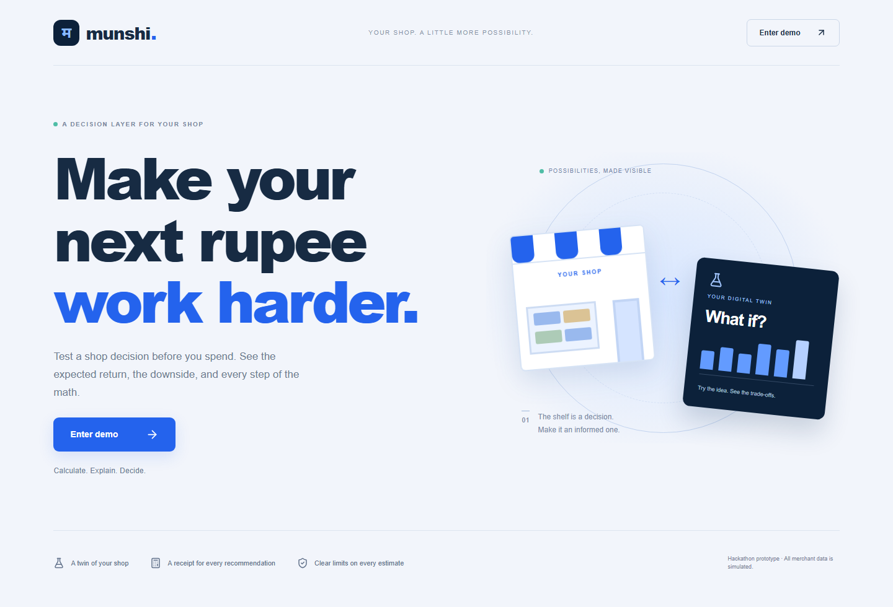
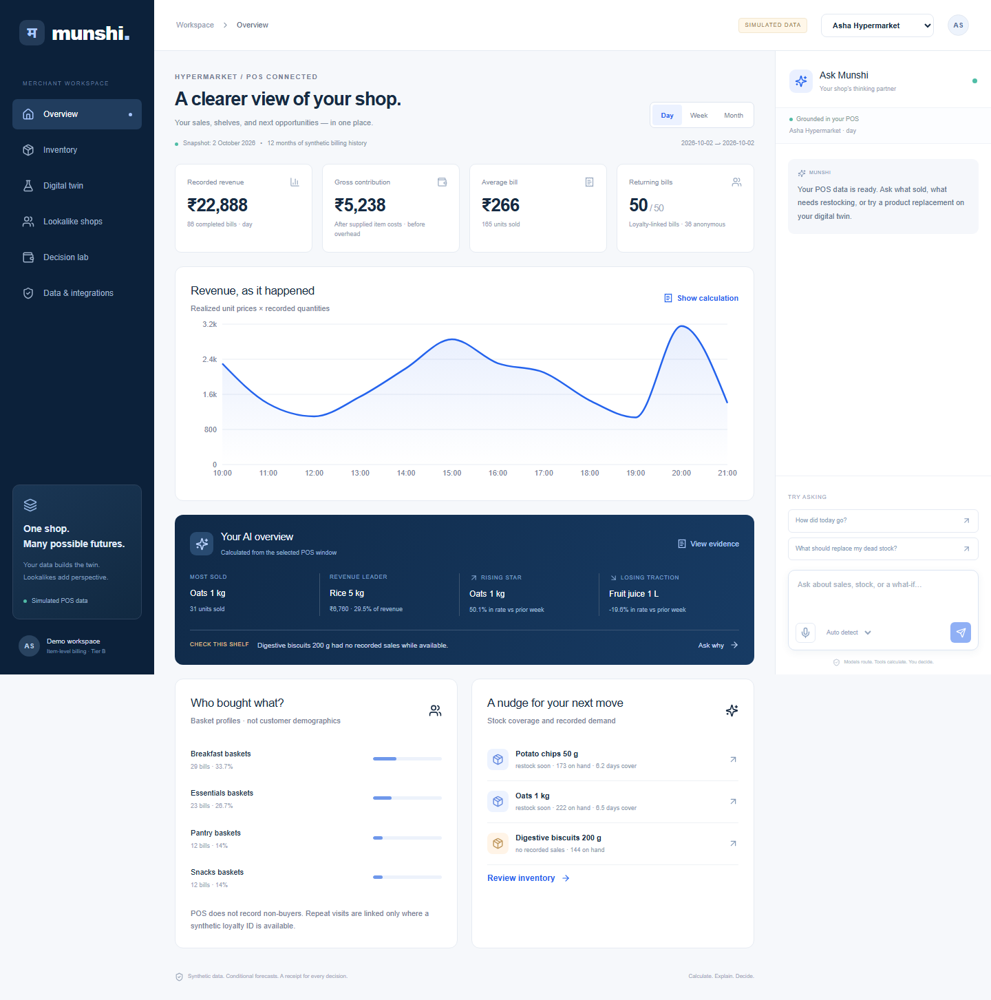

# Pi

**Test a shop decision before spending the next rupee.** A fullscreen landing page opens a standalone merchant workspace. Timestamped POS bills ground the overview; canonical-product lookalikes inform a conditional assortment twin. Every recommendation carries its math and assumptions.

All merchant observations and scenarios are **synthetic**. There is no real Paytm connection, lending offer, delivered message or external purchase order. Speech adapters use Sarvam only when separately enabled; the default build needs no credentials. See [integration status](docs/INTEGRATION_STATUS.md) and [verification report](docs/FINAL_REPORT.md).

## Start locally (verified)

Python 3.12 and Node 22+ recommended. From this folder:

```bash
python -m venv .venv
. .venv/bin/activate
python -m pip install -r api/requirements.txt
cd web && npm ci && cd ..
make seed
make local-api
```

In another terminal:

```bash
. .venv/bin/activate
make local-web
```

Open **http://localhost:3000** → **Enter demo**. The workspace lives at `/demo`; API docs are at http://localhost:8000/docs. The archive includes the generated database and CSV.gz extracts. If absent, data is generated on first use. Use one API worker for this local demo. `make seed` restores the synthetic billing database, including any local invoice-import adjustments.

## Pi insights, regulars and filters

- **Insights are tools.** Most sold, revenue leader, rising, losing traction, check this shelf, replenish soon (with a top-up quantity for 14 days of cover) and regular customers are server-side tools (`api/billing/insights.py`). The Overview cards and the chat agent call the same tools, so a card and a spoken answer can never disagree. Results are cached per shop and period, refreshed in the background every `INSIGHT_REFRESH_SECONDS` (default 900) and on demand with **Refresh** (`POST /v2/insights/{mid}/refresh`).
- **Your regulars** shows how many customers come back for which product and how often ("9 customers - Milk 1 L - every day"), detected from loyalty-linked bills (`api/billing/habits.py`). Habitual customers are seeded into the synthetic history by re-labelling existing bills (`habit_seed.py`), so revenue and stock are unchanged.
- **Inventory** has status filters (replenish soon, no recorded sales, slow moving, healthy, not stocked) with counts, and a top-up column.

## Repricing

Inventory → **Change price** (or Digital twin → **Change a price**) answers *what happens if I sell this at a different price?* It always shows the exact break-even volume, then an evidence check, and a stock-constrained forecast only when the price history supports one. Live history has one price per item, so it shows break-even and withholds demand; the opt-in **Price-test pilot** (synthetic) shows supported forecasts. Chat tools: `reprice` and `recommend_price`. Read-only. See [docs/PRICING_VERIFICATION.md](docs/PRICING_VERIFICATION.md) and the Repricing section of the [math spec](docs/MATH_SPEC.md).

## Two core demos

1. **Grounded shop overview.** Switch between Asha Hypermarket, Annapurna Kitchen and Thread & Co. Day is default; Week and Month show trailing 7/30-day revenue. Inspect units leader, revenue leader, rising/declining rates, no-sale products, stock-cover nudges and purchased-basket profiles. Customer demographics and all visitor arrivals are not inferred.
2. **Peer-informed assortment twin.** Try replacing Digestive biscuits with Millet cookies, or ask `What should I replace Cream pasta with to increase revenue?`. Inspect canonical mapping, same-type exposure-eligible peers, effective cohort size, substitution, stock/recipe constraints, upfront cash, uncertain revenue change and outside-option sensitivity. These are model scenarios, not identified causal uplift.

Inventory also includes an **editable cached supplier-bill extraction** with explicit, atomic and idempotent local stock confirmation. Live image OCR is not connected. **Decision lab** is tier-aware: a *payments-only* view (takings, peak hours, 7-day inflow outlook, plus an explicit list of what payments alone cannot answer) and an *item-level* view (a decision queue built from the insight tools). The old cash/promo/funding fixtures are no longer shown in the UI; their API and tests remain.

See the [three-minute demo script](docs/DEMO_SCRIPT.md), [math specification](docs/MATH_SPEC.md), [assumptions](docs/ASSUMPTIONS.md), [pitch notes](docs/PITCH_NOTES.md) and [revision plan](docs/REVISION_PLAN.md).

## Data

`data/billing.sqlite3` has complete 365-day item-level bills for seven focal shops: hypermarket, restaurant, apparel, kirana, pharmacy, bakery and electronics. `data/billing_manifest.json` records counts, seed, product catalogue, schema and limits. `data/exports/` contains gzip CSVs for POS lines, stock arrivals, availability and donor weekly facts. SQLite can be read directly:

```sql
SELECT b.timestamp, b.id, l.product, l.qty, l.price
FROM bills b JOIN lines l ON l.bill=b.id
WHERE b.merchant='hypermarket'
ORDER BY b.timestamp;
```

There are 280 synthetic donor shops with weekly sufficient statistics; their raw invoices are not stored. Availability is a generated per-bill log, an additional input needed beyond plain POS purchase records. Loyalty IDs are pseudonymous synthetic fixtures. Snapshots are fixed at **2 October 2026**.

## Verify and record

```bash
make test
make eval
cd web && npx playwright install chromium && npm run e2e && cd ..
make record
cd web && npm run build
```

Browser tests start their own API and Next servers; ports 8000/3000 must be free. `make record` records just the two-demo journey to `demo/munshi-demo.webm`. Browser tests mutate local synthetic inventory/legacy sessions; run `make seed` to restore billing stock afterwards. Backend tests use a separate temporary billing database.

`make test` covers numeric/accounting invariants, schemas, guards, peer leakage/eligibility, paired simulations, recipe caps, invoice idempotence and speech request mocks, plus lint, limited mypy and TypeScript. The legacy engine coverage threshold is 85%; billing tests exercise the new namespace separately. `eval/peer_transfer.json` compares merchant-held-out cold-start transfer with a type-item mean on future synthetic weeks. It is not real-world calibration. The earlier keyword suite is not a general language benchmark.

## Optional voice and Gemini

Keep credentials server-side, in your environment or ignored `.env`; never put them in `NEXT_PUBLIC_*` variables. For local shell launch, explicitly export the variables; the app does not automatically source `.env`.

```bash
export SARVAM_VOICE_ENABLED=true
export SARVAM_API_KEY_FILE=/absolute/private/path/sarvam-key
# Or export SARVAM_API_KEY in your private shell.
make local-api
```

Press the mic to record at most 20 seconds, stop, review the original-language transcript, then send it. Auto detect passes `language_code=unknown` to Saaras v4. The predominant detected language is carried into chat; code-mixed speech is not a per-word language guarantee. Read aloud invokes Bulbul v3 in the answer's actual language, not the currently selected dropdown language. The dropdown supports the 11 languages available across text-language identification, translation and TTS; Saaras supports additional languages, with an explicit English fallback for unsupported reply/TTS languages. No automatic TTS or provider retry is made. Speech honors HTTP(S) proxy settings and `NO_PROXY`, ignores unrelated SOCKS settings, and supports `SARVAM_HTTP_PROXY` as an override.

Merchant chat uses **Sarvam only**: configure `SARVAM_CHAT_ENABLED=true`, a server-side `SARVAM_API_KEY` (or private `SARVAM_API_KEY_FILE`) and `SARVAM_CHAT_MODEL=sarvam-105b`. Saaras v4 → Sarvam-105B → Bulbul v3 is an orchestrated cascade, not a native speech-to-speech model. `sarvam-105b-conversations` is an optional lower-latency planner setting; this release defaults to 105B for agentic decisions. No Gemini calls occur in this merchant flow; the old adapter remains for historical test compatibility.

Six separately described tools expose catalogue discovery plus overview, inventory, aggregate peers, replacement trial and replacement ranking. At most two planner calls occur: optional catalogue discovery, then one validated business tool. Merchant identity is server-bound; extra fields, unknown/cross-shop SKUs, inappropriate existing/candidate roles, malformed/parallel calls and out-of-range arguments are rejected. Configured-provider failures clarify instead of masquerading as a successful live route. Without a key, the labeled local constrained router remains available. Engine-owned templates, receipts and numeric authorization produce business answers; model prose is discarded. Tool discovery results are returned as tool messages. The UI's Answer evidence shows provider, execution trace, localization status and canonical English answer.

Automatic text language identification adds one Sarvam request when `language=unknown`; non-English localization adds one translation request. Thus each explicit send uses at most four provider requests (one detection, up to two planner calls, one translation), no retry. Translation retains exact numeric/date token multisets and must pass receipt authorization; this does **not** prove semantic fidelity. Canonical English and receipts remain authoritative. Failed localization retains English and sets TTS to English. Inspect `docs/SARVAM_AGENT.md` for the acceptance matrix and live evaluation instructions. No live Sarvam tool-selection accuracy is claimed.

## Docker (configuration supplied; runtime unverified here)

```bash
cp .env.example .env
docker compose up --build
```

PostgreSQL persists legacy session/memory state; the generated billing store remains SQLite in the shared data volume. The optional n8n automation profile and exported workflows remain available. Docker was unavailable in the build environment; local Python/Next execution is verified. Do not expose the unauthenticated local prototype publicly.






Production work remains: tenant authentication/authorization, audited POS integration, actual OCR, calibrated canonical matching, ANN retrieval, richer covariates, real availability logs, policy/capacity/expiry constraints, controlled assortment trials and financial calibration. Cohort suppression is not differential privacy. Every simulated approval stays local.
